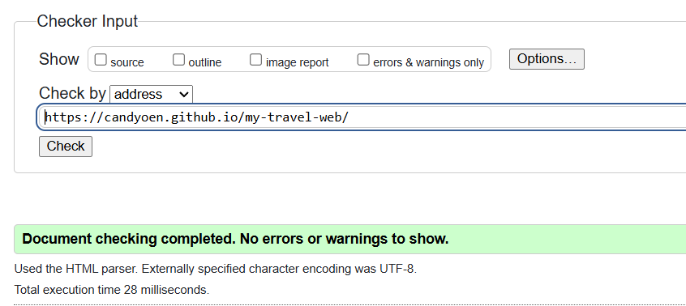
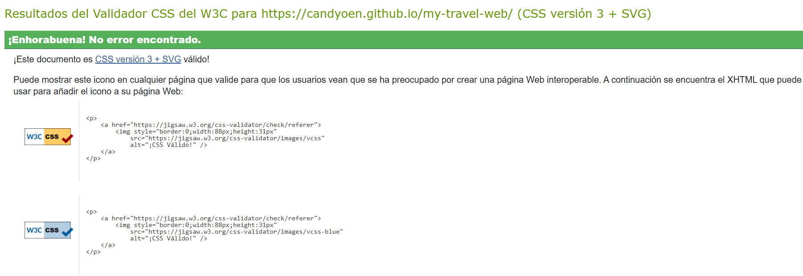
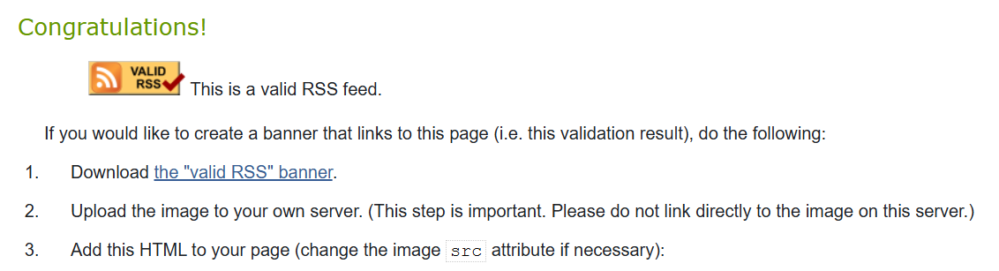

# my-travel-web
# Explorando el Mundo - Blog y Guías de Viaje

Sitio web multiplataforma dedicado al turismo global, que ofrece guías de destinos, artículos de rutas de senderismo, galerías multimedia interactivas, tablas comparativas de presupuestos y un sistema de reservas en línea.

## Autoría

- Nombre y apellidos: [Candela Ana Oen]
- Curso: [1º DAM]
- Módulo: Lenguajes de Marcas y Sistemas de Gestión de Información (LMSGI)
- Fecha: [08/11/2026]

## Sitio publicado

- Web en GitHub Pages: [Abrir sitio](https://candyoen.github.io/my-travel-web/)
- Repositorio: [Abrir repositorio](https://github.com/candyoen/my-travel-web) 

## Estructura del proyecto

- `index.html`: Página principal de bienvenida con acceso rápido a las secciones y resumen del sitio.
- `blog.html`: Artículo principal sobre rutas de senderismo estructurado con marcado semántico avanzado.
- `tabla.html`: Tabla comparativa detallada de destinos internacionales, presupuestos y temporadas.
- `galeria.html`: Galería multimedia integrada con un mapa y recursos de audio y vídeo accesibles.
- `formulario.html`: Formulario de registro y reserva con validación HTML5 y múltiples tipos de entrada.
- `rss.xml`: Canal de sindicación RSS en formato XML con las últimas actualizaciones del sitio.
- `css/estilos.css`: Hoja de estilos principal con diseño adaptable y estructurado para todas las vistas.

## Tecnologías utilizadas

- HTML5 (Estructura semántica)
- CSS3 (Estilos y maquetación)
- XML y RSS (Sindicación de contenidos)
- Git (Control de versiones local)
- GitHub (Alojamiento de código)
- GitHub Pages (Despliegue y publicación web)

## Características principales

- Navegación fluida entre cinco páginas interconectadas.
- Uso riguroso de HTML semántico (`header`, `nav`, `main`, `section`, `article`, `footer`).
- Tabla accesible con cabeceras definidas y estructura semántica.
- Galería con soporte multimedia (`video` con subtítulos y pistas de accesibilidad, y elementos de audio).
- Formulario interactivo avanzado con validación nativa HTML5 y uso obligatorio de `fieldset` y `legend`.
- Canal RSS válido y enlazado correctamente al sitio.

## Validación

### HTML

### CSS

### RSS

## Dificultades encontradas

1. **Configuración de rutas en los recursos multimedia:** Al principio, las rutas de las imágenes y los vídeos no cargaban correctamente al cambiar de subcarpeta. Se resolvió estandarizando el uso de rutas relativas desde la raíz del proyecto.
2. **Sincronización inicial con Git y GitHub:** Hubo un pequeño bloqueo al realizar el primer *commit* y *push* debido al editor de mensajes de Git. Se resolvió cerrando la pestaña temporal de edición (`COMMIT_EDITMSG`) y sincronizando correctamente desde la barra lateral de control de código fuente.
3. **Estructuración semántica del formulario:** Cumplir con la obligatoriedad de usar tres `fieldset` con sus respectivos `legend` sin romper el diseño requirió planificar el formulario dividiéndolo en bloques lógicos (Datos personales, Preferencias y Documentación).

## Decisiones técnicas

- **Organización de archivos:** Se han agrupado los recursos multimedia en carpetas específicas (`img/`, `video/`, `subtitulos/`) para mantener el proyecto limpio y ordenado.
- **Partes repetidas de la plantilla:** Los encabezados principales, la estructura básica de navegación mediante listas (`ul`/`li`) y los pies de página (`footer`) se mantienen idénticos en todas las páginas para dar cohesión visual.
- **Qué cambia en cada página:** El contenido central (`main`), adaptándose específicamente a un blog, una tabla de datos, una galería o un formulario interactivo según corresponda.
- **Formatos de imagen:** Se han seleccionado formatos ligeros (`.jpg`, `.png` y gráficos vectoriales `.svg` para el logotipo) para asegurar tiempos de carga rápidos.
- **Rutas relativas:** Se han empleado exclusivamente rutas relativas (como `css/estilos.css` o `img/foto.jpg`) para garantizar que la web funcione tanto en local como al desplegarse en GitHub Pages sin enlaces rotos.
- **Preparación para CSS:** Se ha diseñado la estructura HTML con clases e identificadores limpios y lógicos, facilitando la futura aplicación de diseños avanzados mediante hojas de estilo.

## Fuentes y licencias

- **Imágenes:** Fotografías de paisajes obtenidas de bancos de imágenes libres de derechos (Unsplash / Pexels) bajo licencia CC0.
- **Vídeos y audios:** Archivos de demostración propios adaptados con subtítulos en formato WebVTT para cumplir con los estándares de accesibilidad.
- **Textos:** Redacción propia original orientada a la temática de guías de viajes y turismo global.